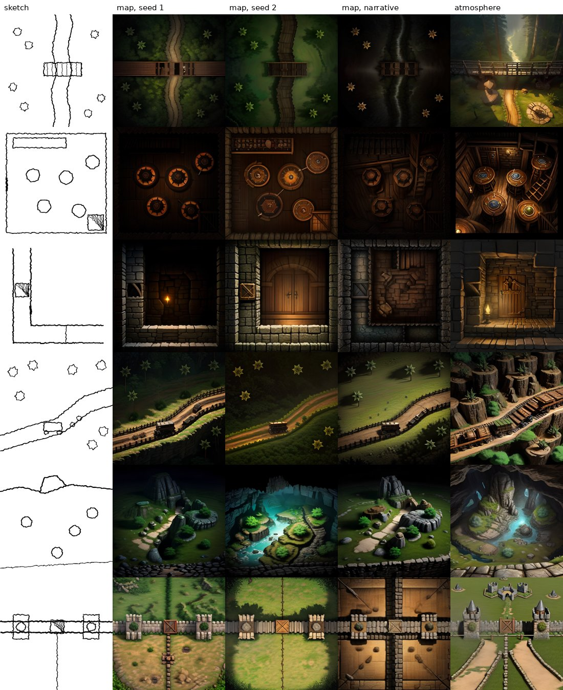

# sketch_to_scene on a GPU: quality and latency (issues #14 and #20)

The preset ran end to end on one rented GPU through the real service: API, Postgres, the C++ worker
with the engine's CUDA backend, and the catalog models (`deploy/gpu-check/pod.sh`,
`deploy/gpu-check/latency.mjs`).

**Setup**
- **GPU**: RTX 4090 (Runpod secure cloud, $0.89/h), engine `ec4df7b`.
- **Map mode**: DreamShaper 8, ControlNet 1.1 scribble (scale 0.9), LCM-LoRA, 4 LCM steps, guidance
  1.5, TAESD, 512 × 512.
- **Atmosphere mode**: the same without the LoRA, 20 euler steps, guidance 7.
- **Every job**: ends with the content classifier (#18).
- **Sketches**: the six spike sketches (`tests/assets/sketches`, from GM Cebi's spike).

## Quality

**Columns**
- the sketch;
- map mode with the spike's English prompt, seeds 1 and 2;
- map mode from the Turkish narrative (the template prompt writer, no LLM);
- atmosphere mode.

**What holds**
- **Layout**: walls, the river line, the road, the round tables, the castle wall with its two towers
  and the gate stay where they were drawn, in map mode and in atmosphere mode.
- **Top-down**: the bridge, tavern and castle scenes read as top-down battle maps.
- **Narrative prompts**: prompts written from the Turkish narratives give results as good as the
  hand-written English ones (#17).

**What does not**
- **Star-shaped trees**: DreamShaper draws the star-shaped tree marks as literal stars.
- **Perspective drift**: the dungeon (a door seen from the front) and the cave (an isometric cliff)
  drift to perspective. The spike saw the same.
- **The river** sometimes comes out as a dirt road: the river is drawn as two lines, like a road.
- **Atmosphere mode** is prettier but freely perspective. That is expected; it is the mode for mood,
  not for tokens.

### Battle-map models with a usable license

The spike found the base model to be the biggest quality lever, so we looked for top-down or
battle-map checkpoints and LoRAs whose license allows hosted commercial use:

| Model | Base | License | Usable? |
|---|---|---|---|
| [Zapper/battlemap-1024](https://huggingface.co/Zapper/battlemap-1024), [battlemap-768-v-10](https://huggingface.co/Zapper/battlemap-768-v-10) | SD 2.x | CreativeML OpenRAIL-M | no: SD 2.x has another text encoder (1024), so the SD 1.5 scribble ControlNet does not fit |
| [Angry-Wizard/SD-Battlemaps](https://huggingface.co/Angry-Wizard/SD-Battlemaps) | SD 1.5 | "cc", no variant given | no: unclear terms |
| [neemspees/dnd-battlemaps](https://huggingface.co/neemspees/dnd-battlemaps) | SD 1.5 | none stated | no |
| [dougdaulton/gcg_battlemaps_01_others](https://huggingface.co/dougdaulton/gcg_battlemaps_01_others), [_02_tam](https://huggingface.co/dougdaulton/gcg_battlemaps_02_tam) | Flux / not stated | MIT tag on re-uploaded LoRAs | no: provenance unclear, base unknown or Flux |
| [Fixedbot/sdxl_dnd_battlemap_lora](https://huggingface.co/Fixedbot/sdxl_dnd_battlemap_lora) | SDXL | Apache-2.0 | not for v1 (SDXL is out of scope: speed, 8 GB GPUs) |
| Flux battle-map LoRAs (Muapi/…, red-asparagus123/rpgmaps) | FLUX.1-dev | the base is non-commercial | no |

**Decision**: **DreamShaper 8** stays the base for map mode
([CreativeML OpenRAIL-M](https://huggingface.co/spaces/CompVis/stable-diffusion-license): hosted
commercial use allowed, with the use restrictions passed on to users in the terms).

The catalog entries, by slug (each deployment has its own asset ids; presets name slugs):

| Slug | Model | License |
|---|---|---|
| `dreamshaper-8` | [Lykon/dreamshaper-8](https://huggingface.co/Lykon/dreamshaper-8) | CreativeML OpenRAIL-M |
| `controlnet-scribble` | [lllyasviel/control_v11p_sd15_scribble](https://huggingface.co/lllyasviel/control_v11p_sd15_scribble) | OpenRAIL |
| `lcm-lora-sd15` | [latent-consistency/lcm-lora-sdv1-5](https://huggingface.co/latent-consistency/lcm-lora-sdv1-5) | OpenRAIL++ |
| `taesd` | [madebyollin/taesd](https://huggingface.co/madebyollin/taesd) | MIT |
| `nsfw-classifier` | [Falconsai/nsfw_image_detection](https://huggingface.co/Falconsai/nsfw_image_detection) (ONNX) | Apache-2.0 |

**Remaining**
- **Real sketches**: GM Cebi's real sketches (5–10, promised in #14) are still to come. Run
  `deploy/gpu-check/pod.sh` with them in `tests/assets/sketches`.
- **Cheaper fixes first**:
  - say "trees" as small circles in the app's legend, which the palette hint in #14 allows;
  - add "perspective, isometric" to the negative prompt for indoor scenes.
- **A custom LoRA**, out of scope in #14, only if the real sketches drift the same way.

## Latency

| | warm worker | cold worker |
|---|---|---|
| map mode, submission to `succeeded` | **2.5 s** (queue 0.1–0.4 s, run 2.1–2.4 s) | 35 s |
| atmosphere mode | 4.6 s | — |
| cold start, broken down | — | fetch 22 s (3.3 GB of models from storage), load 9.5 s, run 3 s |

Under load:
- **The test**: 50 map jobs in a row while a 48-frame morph batch job ran on a second worker
  process on the same GPU.
- **Result**: p50 **3.8 s**, p95 **6.3 s**, max 6.4 s (acceptance: p50 ≤ 5 s, p95 ≤ 10 s).
- **Why above the warm 2.5 s**: the batch job sharing the GPU, and the second worker taking
  interactive jobs once the morph was done. That worker ran with `KEEP_MODELS=3` and reloaded some
  models every job (about 6 s).
- **Without a GPU worker**: submission is refused at once (`job.no_gpu_worker`; tested in the API
  suite).

**What the check fixed**
- **ControlNet on the GPU** (NeuraCraft#78): the ControlNet ran layer by layer while the UNet beside
  it ran as one device pass. Now both do. The map-mode run went from **5.3 s to 2.1–2.4 s** and the
  atmosphere run from **19.6 s to 4.3 s**. The pictures are unchanged (61 dB).
- **LoRA scale parsing** (NeuraCraft#77): an asset id starting with a digit was read as a LoRA scale,
  so every map job failed on the worker.
- **Memory budget** (`deploy/gpu-check/pod.sh`): two worker processes on one GPU need their own
  weight budget (`NEURACRAFT_CUDA_WEIGHTS_GB`). By default each takes 60 % of the device, and both
  ran out of memory.

**Where the 2.4 s goes**
- the content classifier on the CPU: about 0.5 s;
- the text encoder, two ControlNet passes (one per guidance condition) and the UNet: 4 steps;
- TAESD decoding.

Next steps:
- run the ControlNet's two conditions as one batch, like the UNet;
- move the classifier to the GPU;
- wake workers on new jobs instead of every 500 ms (the queue's 0.1–0.4 s).

### By GPU type (issue #43)

Measured on Runpod Secure Cloud, `mode: map` unless noted:

| GPU | Where | Warm map | Warm atmosphere | Cold start |
|---|---|---|---|---|
| RTX 4090 | EU-RO-1, gpu-check (models on local disk) | 2.5 s | 4.3–4.6 s | first job 35 s |
| RTX 4090 | EU-RO-1, a session's pod with the network volume ([session-cold-start.md](session-cold-start.md)) | 3.2 s | — | worker up after 15 s; first job 29.5 s without warm-up (models loaded from the volume, 25 s) |
| RTX 4090 | EUR-IS-2, production, a fallback data centre without the volume (2026-11-09) | 4.6 s (the first real job) | — | ready after 96 s: worker up after 6 s, warm-up 77 s (models downloaded from the server, 63 s) |
| RTX PRO 4500 Blackwell | EU-CZ-1, gpu-check | 4.0–4.4 s | 9.4 s | first job 34 s |
| RTX A5000, RTX A4000, A40, RTX 2000 Ada | — | not measured | — | none was free in Europe or overall on 2026-11-09 |

**The estimate sessions are told** (`capacity.etaSeconds`) covers the warm-up:
- `CAPACITY_EXPECTED_START_SECONDS` (75 s) for a pod with the model cache;
- `CAPACITY_EXPECTED_START_SECONDS_NO_CACHE` (120 s) for one without it.

`capacity.gpu` and `job.gpu` say which GPU it was.

## Warm capacity: the decision

**Choice**: keep **one GPU worker warm, kept for interactive jobs**, during the hours GM Cebi is
used. Do not scale to zero.

**The worker**
- `WORKER_CLASS=gpu INTERACTIVE_ONLY=1 KEEP_MODELS=8`.
- It holds the preset's models (about 6 GB of float weights on the device), so a request at the
  table takes about 2.5 s.

**Why not scale to zero**
- A cold start takes 35 s: the GPU worker downloads 3.3 GB and loads the models.
- A network volume or an image with the models baked in would cut the download, but the load alone
  is still about 10 s plus the machine's own start. That is too long for "during combat".

**Cost**
- An RTX-class card with 16–24 GB is enough: RTX A4000 or A5000, $0.17–0.27/h on Runpod.
- 12 hours a day costs about $60–100 a month; 24/7 about $120–200.
- Long batch jobs go to other workers, or to a second worker process on the same card with its own
  `NEURACRAFT_CUDA_WEIGHTS_GB`. The interactive worker is never busy with them.

**Revisit** when GM Cebi has real usage numbers:
- per-preset p50 / p95 from `cli/latency.js`;
- jobs per hour, from the partner usage endpoint.
